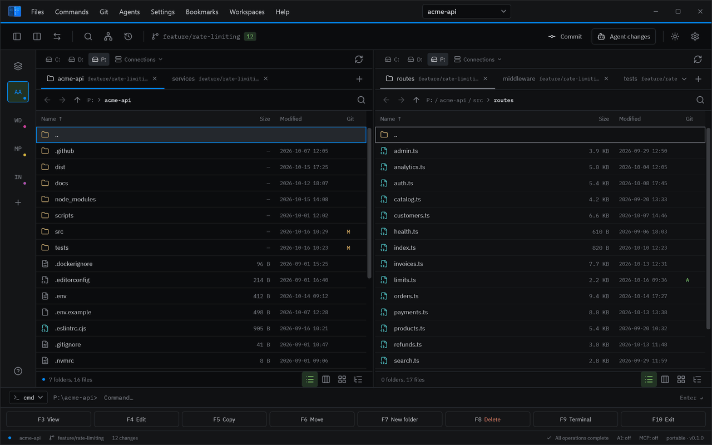

# TCVibe

**A fast, portable dual-pane file manager for Windows, built for developers who work with coding agents.**
Switch between projects in under a second, see what an agent changed, and roll it back in one click.

[](https://github.com/gurinovichroman/TCVibe/releases/latest)
[](LICENSE)



## Why

When agents write most of the code, the bottleneck is reviewing it: what changed, where, and can I
undo it. You also juggle several projects at once, each with its own folders, branches and terminals.
A dual-pane file manager with an operation log, git and undo is already the right surface for
that. TCVibe builds on it.

## Features

- **Workspaces.** A workspace is a project's whole context: both panels, every tab, the layout,
  colour, notes and terminal command. Switch with **Alt+1…9**, the **Alt+W** switcher or the
  workspace rail. Pin them, group them, open one in its own window. A `*.tcvproj` file can be
  committed with the project.
- **Agent changes.** The **Agent changes** dashboard (Ctrl+Shift+D) lists every change in the working
  tree with where it came from (agent, you, or unknown), and rolls any of it back in one click.
  The agent layer is off until you turn it on.
- **MCP server.** A local MCP server (127.0.0.1 only) gives agents your selection, listings, file reads
  and search, including inside archives and open remote panels. Agent writes go through your approval.
- **Git as a workflow.** Worktree dashboard, "new worktree for a task" (branch, folder, `.env` copy,
  setup command, workspace), stage, commit, branches, stash, clone. The branch shows on the tab.
- **Your AI, your choice.** Any OpenAI-compatible endpoint, including local Ollama and LM Studio:
  commit message drafts, summaries in the viewer, rename by content, local semantic search.
- **Navigate like an editor.** Command palette (F1), fuzzy file picker (Ctrl+P) that respects
  `.gitignore`, fast content search, syntax highlighting and Markdown in the viewer (F3).
- **The classics.** Tabs, an operation queue with pause and a log, archives (ZIP, 7z, RAR, TAR, ISO,
  CAB), FTP/FTPS/SFTP/WebDAV and S3/Azure right in the panel, multi-rename with undo, checksums,
  themes, ten interface languages (English, Russian, German, French, Spanish, Italian, Portuguese, Polish, Ukrainian, Dutch).

## Install

1. Download `TCVibe-win-x64-Portable.zip` (`win-x86` for 32-bit Windows) from
   [Releases](https://github.com/gurinovichroman/TCVibe/releases/latest).
2. Unpack it into any folder and run `TCVibe.exe`. No installer, no admin rights.

Requires Windows 10 (1903+) or 11. The .NET runtime is included.

**Updates** install from inside the program: **Help → Check for updates** downloads only what
changed and restarts into the new version. Settings, workspaces and notes live in the `data\` folder
next to the program: they survive updates, and copying the folder moves everything to another PC.
Connection passwords are encrypted for your Windows account and are asked for again on another PC.

> Windows may warn about an unrecognised app on the first start: the binaries are not code-signed yet.
> Choose **More info → Run anyway**, or build it yourself from this repository.

## Privacy

No telemetry, no account. TCVibe goes online only when you ask it to: checking for updates, opening a
connection, or calling the AI endpoint you configured. Everything it stores is in `data\`.

## Feedback

- **Found a bug?** **Help → Report a bug** opens the [bug form](https://github.com/gurinovichroman/TCVibe/issues/new?template=bug_report.yml)
  with your version and Windows filled in. **Help → Open the log folder** gives you the log to attach.
- **Questions and ideas:** [Discussions](https://github.com/gurinovichroman/TCVibe/discussions).
- **Security issues:** please report them privately, see [SECURITY.md](SECURITY.md).

## Build from source

```powershell
dotnet build TCVibe.slnx            # needs the .NET 10 SDK
dotnet test  TCVibe.slnx            # Windows only
dotnet run --project src/TCV.App
tools\publish-portable.ps1          # the portable ZIP and the update feed in artifacts\
```

`src/TCV.Core` holds the interfaces and the plugin SDK, `src/TCV.App` the WPF application,
`src/Plugins` the built-in plugins, `plugins` example external plugins and `tests` the xUnit tests.

## License

[MIT](LICENSE). Third-party components and their licences are listed in
[THIRD-PARTY-NOTICES.txt](THIRD-PARTY-NOTICES.txt).

TCVibe is an independent project, not affiliated with Total Commander or Ghisler Software GmbH.
